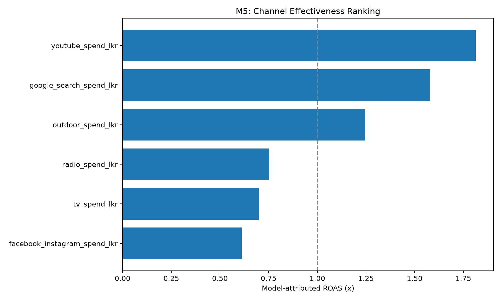
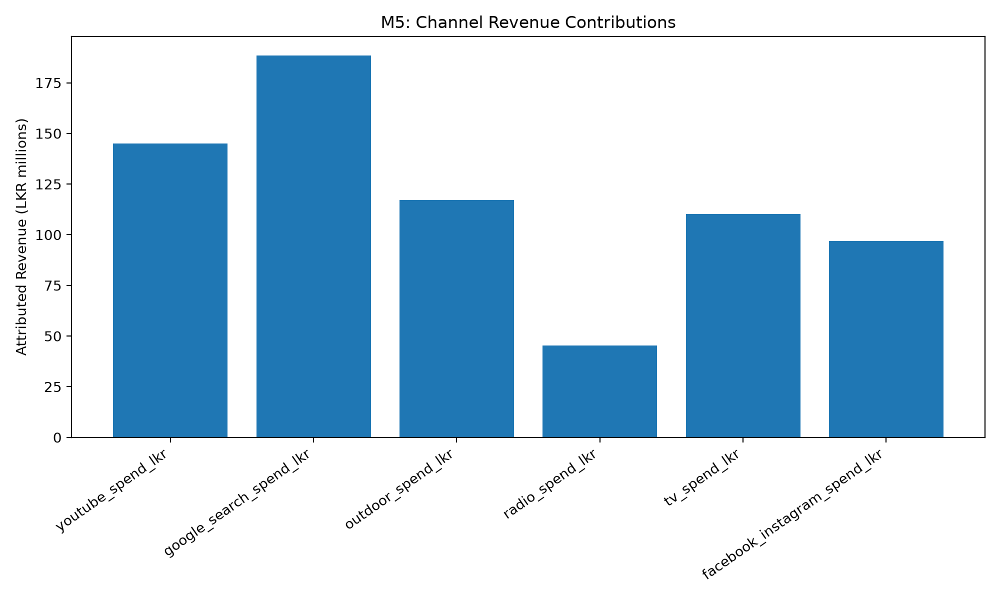
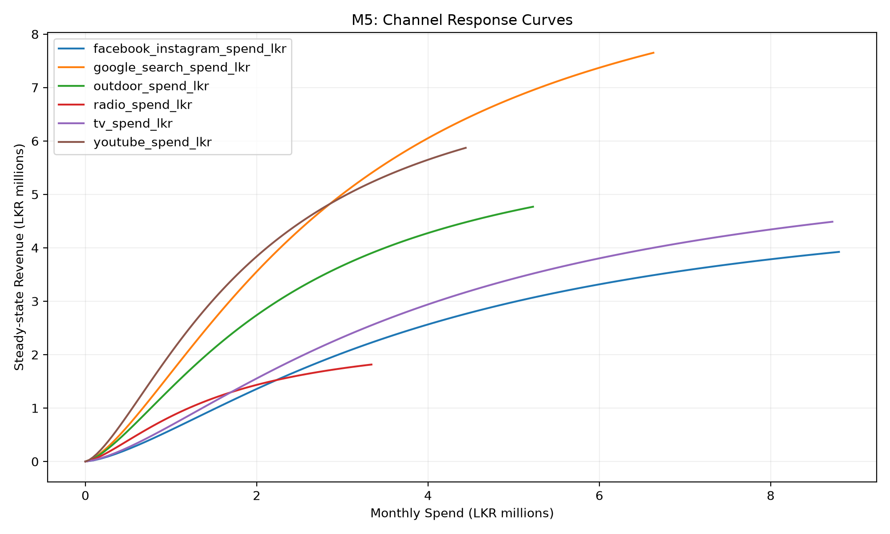

# 05 – Channel Effectiveness and ROI Analysis

## 5.1 Introduction

The objective of this analysis is to evaluate the effectiveness of six advertising channels using the fitted Marketing Mix Model (MMM). The analysis estimates model-attributed revenue contributions, Return on Advertising Spend (ROAS), revenue-based Return on Investment (ROI), and marginal advertising effectiveness.

The results provide a quantitative basis for comparing historical channel performance and informing the subsequent budget optimisation stage.

## 5.2 Methodology

The analysis uses the cleaned monthly marketing dataset containing 36 observations and the deployed M3 Marketing Mix Model.

The model incorporates geometric adstock to represent advertising carryover effects and Hill saturation transformations to capture nonlinear advertising responses.

Channel contributions were extracted using the model's `contributions()` method. Steady-state response curves were generated using `response_curve()`.

The following metrics were calculated:

**ROAS**

ROAS = Model-Attributed Revenue / Advertising Spend

**Revenue-Based ROI**

ROI (%) = (ROAS − 1) × 100

**Contribution Share**

Contribution Share (%) = Channel Contribution / Total Media Contribution × 100

**Marginal ROAS**

Marginal ROAS = Change in Predicted Steady-State Revenue / Change in Monthly Advertising Spend

The reported ROI is based on attributed revenue rather than profit. Therefore, it should not be interpreted as a net financial return.

## 5.3 Channel Effectiveness Results

| Rank | Advertising Channel | ROAS | Revenue-Based ROI (%) | Contribution Share (%) |
|---|---|---:|---:|---:|
| 1 | YouTube | 1.814 | 81.401 | 20.619 |
| 2 | Google Search | 1.579 | 57.923 | 26.810 |
| 3 | Outdoor | 1.247 | 24.662 | 16.678 |
| 4 | Radio | 0.752 | -24.750 | 6.434 |
| 5 | TV | 0.702 | -29.818 | 15.669 |
| 6 | Facebook/Instagram | 0.612 | -38.767 | 13.791 |

YouTube achieved the highest model-attributed ROAS of 1.814, followed by Google Search at 1.579 and Outdoor advertising at 1.247.

Google Search generated the largest share of total model-attributed media revenue, accounting for approximately 26.81%.

Radio, TV, and Facebook/Instagram produced model-attributed ROAS values below 1.0, suggesting lower estimated historical revenue efficiency relative to their advertising expenditure.

These estimates represent model attribution rather than experimentally established causal effects.

### Figure 5.1: Channel ROAS Ranking

Figure 5.1 compares the model-attributed ROAS of the six
advertising channels. YouTube achieved the highest ROAS,
followed by Google Search and Outdoor advertising.

### Figure 5.2: Channel Revenue Contributions

Figure 5.2 illustrates the estimated revenue attributed
to each advertising channel. Google Search generated
the largest total model-attributed revenue contribution.

## 5.4 Marginal Channel Effectiveness

Marginal ROAS was estimated from the slope of each channel's steady-state advertising response curve at its historical average monthly spending level.

| Channel | Marginal ROAS |
|---|---:|
| YouTube | 1.266 |
| Google Search | 1.108 |
| Outdoor | 0.875 |
| Radio | 0.518 |
| TV | 0.499 |
| Facebook/Instagram | 0.430 |

YouTube and Google Search demonstrated the highest estimated marginal advertising effectiveness.

Outdoor advertising exhibited a marginal ROAS below 1.0 despite having a historical attributed ROAS above 1.0. This illustrates the distinction between average historical efficiency and the expected incremental return from additional spending.

The Hill saturation transformation captures nonlinear responses, meaning additional advertising expenditure may generate progressively smaller incremental benefits over relevant spending ranges.

### Figure 5.3: Channel Response Curves

Figure 5.3 presents the estimated steady-state revenue
response to different monthly advertising spending levels.

The curves illustrate nonlinear advertising responses
and help evaluate diminishing returns and marginal
channel effectiveness.

## 5.5 Model Validation and Limitations

The M3 model produced the following holdout evaluation metrics:

- MAPE: 6.177%
- R²: -0.417
- NRMSE: 7.083%

Although the MAPE is relatively low, the negative holdout R² indicates that the model performed worse than a constant prediction based on the holdout mean under the R² comparison.

Therefore, the channel-level ROI and marginal effectiveness estimates should be interpreted cautiously.

Additional limitations include the relatively small sample of 36 monthly observations, possible correlations between advertising channels, model specification uncertainty, and the absence of profit margin data.

The model-attributed contributions do not establish causal incremental revenue, and the revenue-based ROI figures should not be interpreted as profitability estimates.

## 5.6 Recommendations

Based on the current model estimates, YouTube and Google Search should be prioritised for further investigation because they exhibit the highest historical ROAS and marginal ROAS.

Outdoor advertising may warrant maintaining or carefully testing its current expenditure, as its estimated marginal ROAS is below 1.0.

Radio, TV, and Facebook/Instagram should undergo additional performance evaluation before any major budget reductions are implemented.

Budget reallocations should be tested using controlled experiments, scenario analysis, and sensitivity checks rather than relying solely on the current MMM rankings.

The M6 optimisation component should use the channel response curves and marginal returns while considering the uncertainty associated with the model's holdout performance.

## 5.7 Conclusion

The M5 analysis provides a structured comparison of six marketing channels using model-attributed revenue, ROAS, revenue-based ROI, and marginal effectiveness.

YouTube and Google Search emerge as the strongest channels under the current model estimates, while other channels show lower estimated efficiency.

However, the model's negative holdout R² limits confidence in the precision and reliability of these results.

The analysis provides an exploratory basis for budget optimisation rather than definitive evidence for immediate advertising budget reallocation.